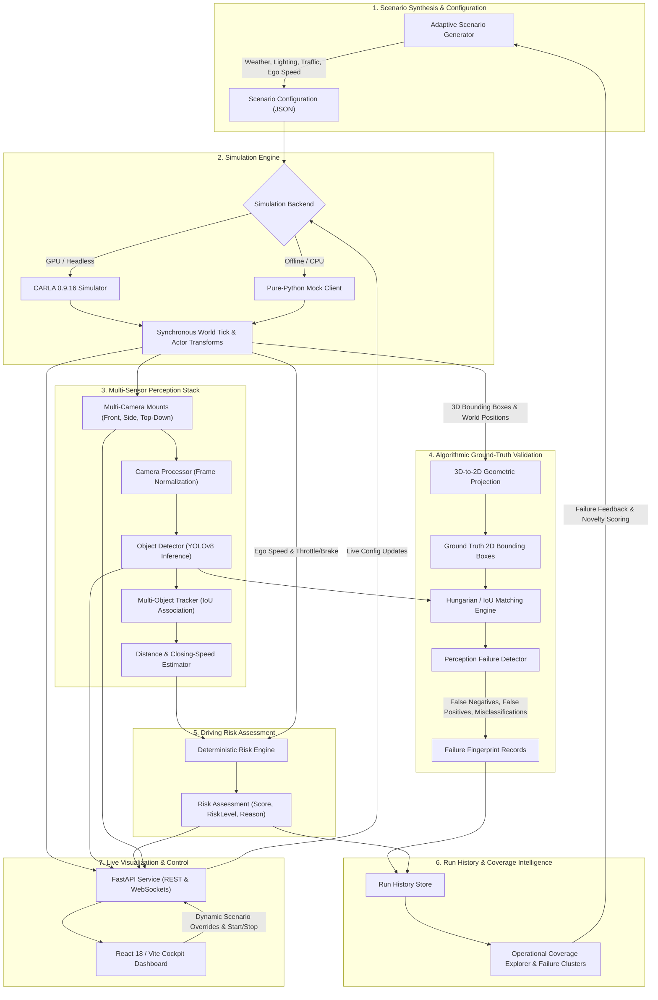

# EdgeForge

> **Autonomous Driving Perception Validation & Edge-Case Discovery Platform**

EdgeForge is an open, closed-loop verification platform designed to stress-test ADAS and Autonomous Vehicle (AV) perception systems against safety-critical edge cases. By combining high-fidelity physical simulation, real-time object detection, ground-truth algorithmic validation, and failure-guided scenario synthesis, EdgeForge systematically identifies perception breakdowns before algorithms reach the road.

---

## 🎯 What is EdgeForge?

Modern autonomous driving systems perform well under nominal conditions, but safety is dictated by the **long tail of rare, critical edge cases**—sudden pedestrian cut-ins, blinding lens flare, heavy rain spray, low-light occlusions, and high closing-speed hazards.

**EdgeForge bridges the gap between passive dataset benchmarking and active simulation testing:**

- **Active Stress-Testing:** Replaces static image evaluation with dynamic, closed-loop simulation environments.
- **Real-Time Perception Validation:** Projects simulator 3D ground truth directly into 2D camera coordinate frames to mathematically score YOLO detections frame-by-frame.
- **Failure-Guided Scenario Synthesis:** Mines previous detection failures to synthesize increasingly targeted scenarios, exposing systematic blind spots rather than relying on uniform random fuzzing.
- **Explainable Safety Metrics:** Evaluates vehicle safety through deterministic, physical parameters—such as Time-to-Collision (TTC), closing speed, and distance clearance—rather than black-box approximations.
- **Dual-Engine Architecture:** Operates with high-fidelity CARLA 0.9.16 3D simulation or in a lightweight, pure-Python mock mode that runs 100% offline without requiring a dedicated GPU or simulator installation.

---

## 🔄 How It Works: The Closed-Loop Flow

EdgeForge operates as a continuous feedback loop consisting of seven core stages:



---

## 🧩 Core Architecture & Subsystems

### 1. Multi-Camera Perception & Tracking Stack
EdgeForge deploys a multi-sensor camera rig attached to the ego vehicle:
- **Front RGB Camera:** Primary forward-facing sensor powering real-time YOLOv8 object detection, 2D bounding-box localization, and confidence scoring.
- **Right-Side Camera:** Lateral situational awareness feed for intersection cross-traffic and lane-change hazard observation.
- **Top-Down Camera:** High-angle bird's-eye perspective (20m elevation, $-90^\circ$ pitch) providing spatial overview of all nearby actors and scene layout.

Frames flow through a standardized perception pipeline:
- **Detection:** Ultralytics YOLOv8 extracts 2D bounding boxes, class labels, and confidence metrics, mapped into canonical ADAS classes (`car`, `pedestrian`, `truck`, `bus`, `motorcycle`, `bicycle`, `traffic_light`, `stop_sign`).
- **Tracking:** Frame-to-frame IoU association maintains continuous actor track histories and stable track IDs across consecutive simulation frames.
- **Monocular Geometry:** Distance and relative closing speeds are derived using camera intrinsic geometry, pinhole camera projection equations, and optical bounding-box progression.

### 2. Ground-Truth Validation & Failure Categorization
Unlike traditional benchmarking that relies on manual post-hoc labeling, EdgeForge evaluates perception accuracy algorithmically in real time:
- **Geometric 3D-to-2D Projection:** Simulator 3D actor bounding boxes and world transforms are dynamically projected into camera sensor coordinates through intrinsic and extrinsic camera matrices.
- **1-to-1 Bounding Box Matching:** Uses greedy and Hungarian IoU matching to pair predicted detections against true simulated objects.
- **Automated Failure Classification:**
  - **False Negatives (Missed Objects):** High-hazard obstacles present in the scene that the detector failed to identify.
  - **False Positives (Ghost Detections):** Spurious detections reported where no physical object exists.
  - **Misclassifications:** Objects detected with adequate IoU overlap but assigned the wrong semantic category (e.g., pedestrian categorized as a bicycle).
  - **Severe Distance Underestimations:** Detected objects where the estimated distance significantly deviates from ground truth, compromising emergency braking logic.

### 3. Explainable Risk Engine
EdgeForge couples perception output with ego vehicle physics to compute clear, deterministic safety metrics:
- **Physics-Based Calculations:** Evaluates Time-to-Collision (TTC), clearance distance, and relative closing velocity between the ego vehicle and lead actors.
- **Categorical Risk Levels:** Maps quantitative hazards into discrete risk tiers (**LOW**, **MEDIUM**, **HIGH**, **CRITICAL**).
- **Explainable Diagnostics:** Produces plain-text reasoning strings (e.g., *"Critical closing speed of 18.5 m/s with lead car at 8.2m distance; TTC 0.44s exceeds emergency braking threshold"*) for transparency and audit compliance.

### 4. Failure-Guided Scenario Generation & Coverage
Rather than generating random scenarios, EdgeForge utilizes an intelligent feedback loop:
- **Failure Fingerprinting:** Every perception breakdown is tagged with environmental metadata (precipitation, fog, sun azimuth, wetness, traffic density, occlusion ratio, distance band).
- **Adaptive Scenario Mutation:** The generator samples under-tested operational design domains (ODD) and perturbs scenario parameters around known failure clusters to find the boundaries of system capability.
- **Coverage Exploration:** Maps scenario parameter spaces across weather, lighting, and density dimensions to ensure comprehensive safety testing.

### 5. Dual Backend Strategy: CARLA & Pure-Python Mock
EdgeForge features an isolated simulation boundary:
- **CARLA 0.9.16 Backend:** High-fidelity physical simulation featuring synchronous execution, dynamic weather presets, TrafficManager autonomous vehicle spawners, and realistic physics interactions.
- **Pure-Python Mock Backend:** Fully functional synthetic test double simulating ego motion, traffic movement, bounding box trajectories, and telemetry. Enables rapid testing, CI/CD pipeline automation, and local development on standard laptops without a GPU or CARLA installation.

### 6. Interactive Cockpit Dashboard & FastAPI Integration
A modern React 18 / Vite frontend pairs with an in-process FastAPI backend:
- **Live Telemetry & Streams:** Multiplexed MJPEG live camera feeds, live bounding-box overlays, vehicle velocity/steering telemetry, and real-time detection tables.
- **Dynamic Simulation Controls:** Start/stop mock simulations, toggle live execution, and adjust weather (rain, fog, wetness), traffic density, and lighting parameters dynamically via REST and WebSocket channels.
- **Offline Presentation Mode:** Bundled benchmark datasets and interactive UI components allow demonstration of failure analysis, scenario labs, and coverage explorers without a running backend.

---

## 📊 End-to-End Execution Flow (Single Simulation Frame)

```
[ Simulation Tick: t = n ]
  │
  ├─► Physics / World Update: Actors move, weather applies, ego state advances
  │
  ├─► Multi-Camera Capture: Synchronous RGB buffers rendered for Front, Side, & Top-Down
  │
  ├─► Perception Pipeline:
  │     ├─ YOLOv8 inference produces 2D boxes, scores, and class labels
  │     ├─ Tracker assigns persistent object IDs across frames
  │     └─ Geometry estimator computes distance and closing speeds
  │
  ├─► Ground Truth Validation:
  │     ├─ 3D actor boxes projected to 2D image coordinates
  │     ├─ Ground truth vs predicted IoU matching
  │     └─ Detection failures classified & fingerprinted
  │
  ├─► Risk Evaluation:
  │     └─ TTC & clearance computed; hazard tier assigned
  │
  ├─► Persistence & API Stream:
  │     ├─ Telemetry, detections, and risk score published to runtime buffer
  │     ├─ WebSocket pushes updated snapshot to frontend
  │     └─ MJPEG encoder broadcasts annotated camera frames
  │
[ Complete: Frame ready for analysis & UI display ]
```

---

## 🛡️ Failure Taxonomy & Safety Thresholds

| Failure Type | Trigger Condition | Safety Impact |
| :--- | :--- | :--- |
| **False Negative (FN)** | Ground-truth object exists within sensor range ($d < 50\text{m}$), but no predicted detection achieves $\text{IoU} \ge 0.5$. | **Critical**: Unseen vehicle or pedestrian; imminent collision risk if unobstructed. |
| **False Positive (FP)** | Predicted detection with confidence $\ge 0.5$ has no matching ground-truth object ($\text{IoU} < 0.1$). | **Medium/High**: Phantom braking, unnecessary avoidance maneuvers, or rear-end collision hazards. |
| **Misclassification** | Object detected with $\text{IoU} \ge 0.5$, but predicted class contradicts ground truth (e.g., pedestrian identified as vehicle). | **High**: Miscalculated actor dynamics, braking profiles, or trajectory predictions. |
| **Distance Error** | Estimated distance deviates by more than $\pm 25\%$ or $> 5\text{m}$ from true 3D Euclidean distance. | **High**: Premature or delayed emergency braking activation. |
| **Critical Risk Alert** | Computed Time-to-Collision ($\text{TTC}$) $< 1.5\text{s}$ or clearance distance $< 5.0\text{m}$ at velocity $> 10\text{m/s}$. | **Critical**: Immediate emergency collision avoidance required. |

---

## 🛠️ Technology Stack

| Domain | Technologies |
| :--- | :--- |
| **Simulation** | CARLA 0.9.16 (Unreal Engine 4), Synchronous Step API, Python CARLA Client |
| **Perception & AI** | PyTorch, Ultralytics YOLOv8, OpenCV, NumPy, FilterPy / IoU Tracking |
| **Backend & Contracts** | Python 3.10+, FastAPI, Pydantic v2, Uvicorn, WebSockets, Loguru |
| **Frontend & UI** | React 18, Vite, TailwindCSS, Lucide Icons |
| **Quality & Testing** | Pytest, Pytest-Cov, AnyIO, Node Test Runner |
